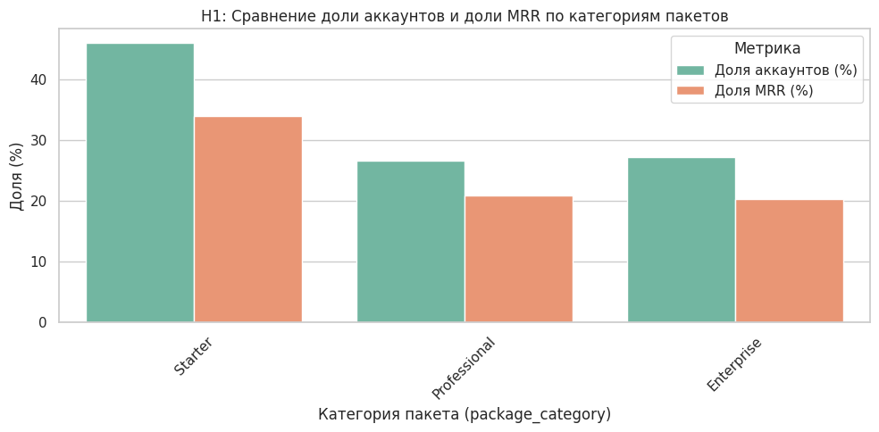
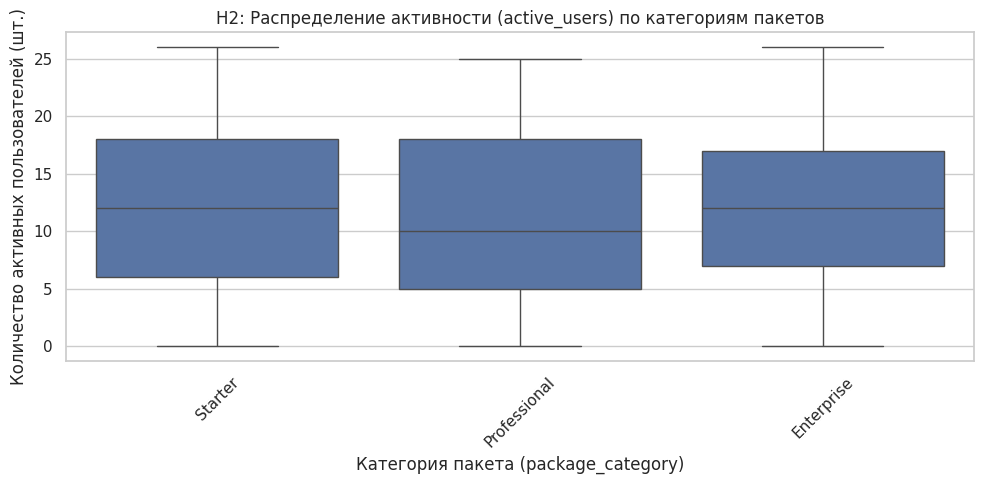
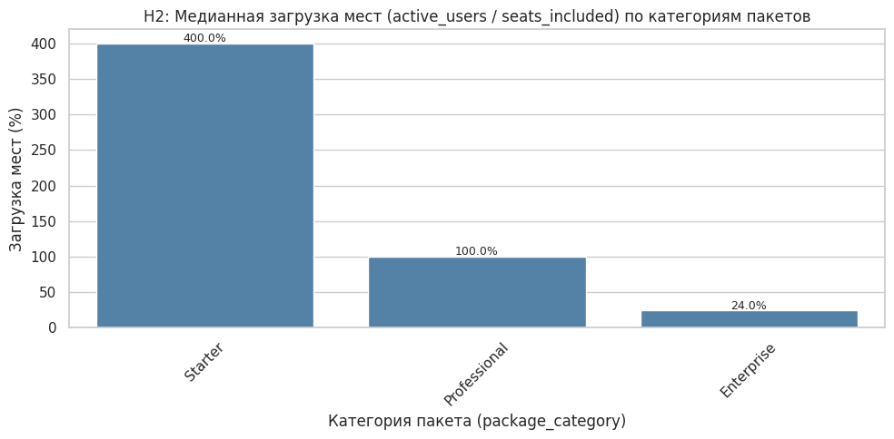
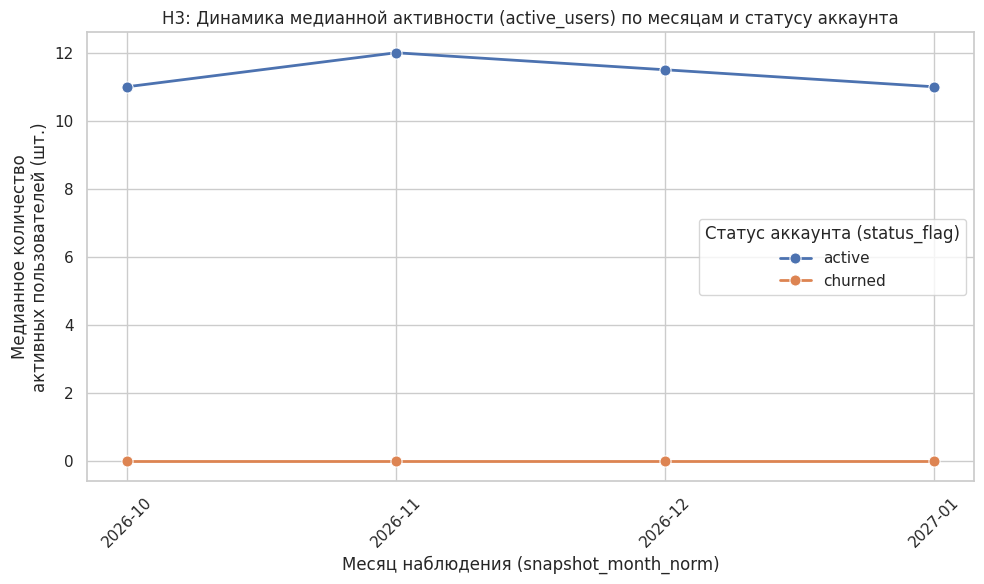

# Разведочный анализ (EDA): использование рабочих пространств FlowBoard по пакетам подписки

**Компания:** FlowBoard (B2B-сервис для совместной работы и управления проектами)
**Период данных:** октябрь 2026 – январь 2027 (4 месяца)
**Автор:** Наталья Мартынова · Проект Спринта 4, домен SaaS
**Среда:** Google Colab, Python (pandas, numpy, matplotlib, seaborn)

---

## 1. Постановка задачи

**Главный бизнес-вопрос.** Какие пакеты подписки (Starter, Professional, Enterprise) формируют основную долю MRR (поле `mrr_proxy_rub_num`), как активность аккаунтов (`active_users`) связана с пакетом и как меняются выручка, активность и отток от октября 2026 к январю 2027?

**Рабочие гипотезы.**

- **H1.** Выручка сконцентрирована в платных пакетах. Starter даёт большую часть аккаунтов, но малую долю MRR, а Professional и Enterprise вместе дают основную часть MRR при меньшей доле аккаунтов.
- **H2.** Активность растёт вместе с размером пакета, но не пропорционально числу мест. Медиана `active_users` растёт от Starter к Enterprise, загрузка мест (`active_users / seats_included`) различается по пакетам, а активность положительно коррелирует с MRR.
- **H3.** К концу года поведение меняется: активность и MRR в декабре–январе отличаются от октября–ноября (сильнее у trial, чем у paid), а churned-аккаунты менее активны и чаще дают негативные комментарии.

Аудитория: команда роста (Growth) и руководство. Результат фиксирует текущую картину и точки внимания, без рекомендаций и планов экспериментов.

---

## 2. Описание данных

| Параметр | Значение |
|---|---|
| Источник | Финальный файл Проекта Спринта 3 (`df.csv`), очищенная выборка |
| Объём | 20 000 строк = 5 000 аккаунтов × 4 месяца |
| Зернистость | Одна строка = активность одного рабочего пространства за один месяц (`account_id` × `snapshot_month`) |
| Столбцы | 16 исходных (12 `object`, 4 `float64`) + `package_category` (добавлен в EDA через `map` по `package_code`) |
| Среда | Google Colab, pandas |

**Очистка.** По отметке в ноутбуке данные прошли очистку в Спринте 3: дубликаты устранены, невалидные значения приведены к NaN без подстановки средних. Пропуски в `package_code` не заполнялись. В EDA-ноутбуке повторная проверка `duplicated()` не запускалась.

**Состав полей и заполненность (из `df.info()`):**

| Поле | Тип | Непустых | Пропусков |
|---|---|---|---|
| `account_id`, `snapshot_month_norm`, `segment`, `status_flag` | object | 20 000 | 0 |
| `plan_code`, `product_name`, `product_line`, `package_code` | object | 15 400 | 4 600 (23,0%) |
| `price_rub` | float64 | 15 400 | 4 600 (23,0%) |
| `seats_included` | float64 | 15 092 | 4 908 (24,5%) |
| `active_users` | float64 | 19 573 | 427 (2,1%) |
| `mrr_proxy_rub_num` | float64 | 18 364 | 1 636 (8,2%) |
| `comment_text_clean`, `comment_theme`, `comment_sentiment`, `comment_summary` | object | 18 947 | 1 053 (5,3%) |

Распределение строк по пакетам: Starter 7 100, Enterprise 4 200, Professional 4 100, без кода пакета 4 600.

**Ключевые статистики (pandas):**

| Поле | Среднее | Медиана | Q1 | Q3 | IQR | Мин | Макс | Граница выбросов Q3+1,5·IQR |
|---|---|---|---|---|---|---|---|---|
| `active_users` | 11,73 | 11 | 6 | 18 | 12 | 0 | 26 | 36 (выбросов нет) |
| `mrr_proxy_rub_num` | 23 426,81 | 23 413,75 | 10 414,26 | 36 339,60 | 25 925,33 | 0 | 55 587,94 | 75 227,60 (выбросов нет) |

**Корреляции (Пирсон):** `active_users`–`mrr_proxy_rub_num` 0,083; `price_rub`–`mrr_proxy_rub_num` 0,005; `active_users`–`price_rub` −0,001; `price_rub`–`seats_included` 0,982.

---

## 3. График + инсайт

### Блок 1. H1: доли аккаунтов и MRR по пакетам



**Числа из pandas** (`groupby('package_category')`, всего MRR 430,21 млн руб.):

| Пакет | Строк | Строк с MRR | MRR, млн руб. | Доля от всего MRR | Среднее MRR на строку, руб. |
|---|---|---|---|---|---|
| Starter | 7 100 | 6 527 | 146,51 | 34,1% | 22 446 |
| Professional | 4 100 | 3 773 | 89,78 | 20,9% | 23 796 |
| Enterprise | 4 200 | 3 857 | 87,50 | 20,3% | 22 686 |
| Без кода пакета | 4 600 | 4 207 | 106,42 | 24,7% | ≈25 300 |

**Инсайт.** Доля MRR близка к доле строк в каждом пакете. Starter даёт 34,1% MRR при 35,5% строк (7 100 из 20 000), Professional и Enterprise вместе дают 41,2% MRR при 41,5% строк. Starter остаётся самым крупным источником MRR (146,5 млн руб.), поэтому H1 не подтверждена. Среднее MRR на строку почти одинаково у всех пакетов (22,4–23,8 тыс. руб.), хотя `price_rub` равен 0, 990 и 2 990 руб. Корреляция цены и MRR составляет 0,005. Группа без кода пакета (23% строк) приносит 24,7% MRR.

**Проверка.**
- *Сверка с кодом.* Доли в таблице сходятся: 34,05 + 20,87 + 20,34 + 24,74 = 100%. Внутри трёх размеченных пакетов MRR делится как 45,2% / 27,7% / 27,0%, строки — как 46,1% / 26,6% / 27,3%. Столбцы на графике выше нельзя сравнивать напрямую: доля аккаунтов посчитана только по размеченным строкам (в сумме 100%), а доля MRR отнесена ко всему MRR вместе с группой без кода (три столбца дают 75,3%). Поэтому разрыв 46% и 34% у Starter частично вызван разной базой расчёта.
- *Альтернативные объяснения.* (1) MRR-прокси строится не от прайс-листа (например, от числа мест или от платежей), поэтому «ярлык» пакета не меняет выручку на строку. (2) В группе без кода пакета могут быть аккаунты любого пакета. Эта группа имеет самое высокое MRR на строку, и распределение долей между тремя пакетами зависит от того, как её учитывать.

### Блок 2. H2: активность и загрузка мест




**Числа из pandas:**

| Пакет | Медиана `active_users` | Мест в пакете | Медианная загрузка мест |
|---|---|---|---|
| Starter | 12 | 3 | 400,0% |
| Professional | 10 | 10 | 100,0% |
| Enterprise | 12 | 50 | 24,0% |
| Без кода пакета | 11 | нет данных | не рассчитана (NaN) |

**Инсайт.** Медиана активных пользователей лежит в коридоре 10–12 и не растёт от Starter к Enterprise. Корреляция активности с MRR слабая (0,083). Загрузка мест при этом падает с 400% (Starter) до 24% (Enterprise). Максимум `active_users` в выборке равен 26, а у Enterprise включено 50 мест. Первая часть H2 (рост активности с пакетом) не подтверждена. Вторая часть (загрузка различается по пакетам) подтверждена.

**Проверка.**
- *Сверка с кодом.* Подписи на графике (400,0 / 100,0 / 24,0%) совпадают с таблицей `median_utilization`. Обратный расчёт сходится: 12 / 3 = 400%, 10 / 10 = 100%, 12 / 50 = 24%. В первом тексте модели стояло «в среднем 400%», фактически это медиана, в отчёте исправлено.
- *Альтернативные объяснения.* (1) Различие в загрузке следует из устройства показателя: активность одинакова, а знаменатель `seats_included` ступенчато растёт (3, 10, 50), поэтому отдельной «обратной зависимости» тут может не быть. (2) `seats_included` может означать лимит оплаченных мест, а `active_users` может считаться иначе (например, включать гостей). Это объяснило бы превышение лимита в 4 раза у Starter. В ноутбуке определение поля не проверялось.

### Блок 3. H3: динамика к концу года



**Числа из pandas** (суммарный MRR по месяцам, млн руб., из таблицы `revenue_by_month_package`):

| Месяц | Starter | Professional | Enterprise | Без кода | Всего |
|---|---|---|---|---|---|
| 2026-10 | 38,43 | 23,14 | 21,02 | 26,95 | 109,55 |
| 2026-11 | 35,87 | 19,40 | 18,06 | 29,06 | 102,39 |
| 2026-12 | 36,27 | 23,53 | 24,14 | 25,25 | 109,19 |
| 2027-01 | 35,94 | 23,71 | 24,27 | 25,17 | 109,09 |
| Янв. к окт. | −6,5% | +2,5% | +15,4% | −6,6% | −0,4% |

Медианная активность у `active` по графику: 11 → 12 → 11,5 → 11 пользователей; у `churned` равна 0 во все четыре месяца.

**Инсайт.** Активность активных аккаунтов стабильна (11–12), сдвига к концу года нет. Суммарный MRR падает в ноябре (−6,5% к октябрю) и в декабре возвращается к уровню октября (январь −0,4% к октябрю). Динамика по пакетам неодинакова: Professional и Enterprise к декабрю–январю выходят на уровень октября или выше (+2,5% и +15,4%), Starter остаётся ниже октября (−6,5%), а группа без кода пакета движется в противофазе (ноябрь +7,8%, декабрь −13,1%). При стабильной активности MRR меняется, то есть выручка и активность не связаны. У churned-аккаунтов медианная активность равна 0.

**Проверка.**
- *Сверка с кодом.* Проценты в таблице посчитаны из выгруженных сумм. В аудите ИИ было сказано, что Starter повторяет динамику старших пакетов (восстановление до ~36 млн руб.). Это неточно: Starter в январе остаётся на 6,5% ниже октября. В отчёте использована цифра из таблицы.
- *Альтернативные объяснения.* (1) Нулевая медиана у churned может быть следствием определения статуса (аккаунт без активности помечен как churned), и тогда «churned менее активны» верно по построению. (2) Сезонность биллинга (продления, индексация) или структура `mrr_proxy_rub_num`, не связанная с числом пользователей, объяснили бы рост MRR при плоской активности. Данных для проверки этих версий в датасете нет.
- *Не проверено в ноутбуке:* разбивка динамики по `segment` (trial и paid), доля churned по месяцам, связь `comment_sentiment` с активностью и оттоком. Эти части H3 остаются без подтверждения и опровержения.

---

## 4. Итоговый вывод

За октябрь 2026 – январь 2027 MRR-прокси распределяется между пакетами примерно пропорционально числу строк (Starter 34,1% при 35,5% строк), а активность (медиана 10–12 пользователей) от пакета не зависит, поэтому загрузка мест падает с 400% до 24% из-за разницы в `seats_included`. После ноябрьского спада (−6,5%) суммарный MRR к декабрю возвращается к уровню октября (109,1–109,2 против 109,6 млн руб.), при этом активность остаётся плоской, а динамика по пакетам расходится. Точки внимания: 23% строк без кода пакета дают 24,7% MRR, MRR-прокси не связан с прайс-листом (r = 0,005), а часть H3 (trial и paid, тональность, отток по месяцам) в этом EDA не проверена.

---

## 5. Приложение: промпты, код, ссылка

**Ноутбук:** `project_sprint_04_SaaS_Martynova_N.ipynb` · Colab: [EDA_report_FlowBoard/project_sprint_04_SaaS_Martynova_N.ipynb]. Ячейки указаны по порядку в файле (нумерация с 0).

### 5.1. Перечень ключевых запросов к ИИ

| № | Тип | Ячейки | Содержание запроса | Результат |
|---|---|---|---|---|
| 1 | Постановка задачи | 1–8 | Скилл уточнения аналитической задачи: контекст FlowBoard, поля датасета, период | Бизнес-вопрос и гипотезы H1–H3 |
| 2 | Статистики / код | 11–13 | Добавить колонку `package_category` по расшифровке кодов PKG-001/002/003 и сгруппировать выручку | Маппинг, доли MRR, динамика по месяцам |
| 3 | Статистики / код | 15–16 | Скрипт: `.info()`, `.shape`, среднее, медиана, Q1, Q3, IQR, мин, макс, граница Q3+1,5·IQR, `.corr()`, группировки | Таблицы статистик и корреляций (раздел 2) |
| 4 | Визуализация | 18–20 | Подобрать 2–3 типа графиков под H1–H3 и написать код (seaborn, `figsize=(10, 5)`, подписи с единицами) | Grouped bar, boxplot, bar загрузки, line |
| 5 | Отладка | 21–22 | Подписи процентов не совпали со столбцами; подпись оси Y не поместилась | Исправленный код (порядок `pkg_order`, перенос строки, `figsize=(10, 6)`) |
| 6 | Описание графиков | 23–26 | Описать график: оси, значения столбцов, максимум, минимум, разница, среднее | Текстовые описания четырёх графиков |
| 7 | Инсайты | 28–30 | Сформулировать инсайт из 2–4 предложений по числам и описанию графика, без рекомендаций и A/B | Черновые инсайты H1–H3 |
| 8 | Проверка | 32–36 | Аудит инсайта на ошибки + 1–2 альтернативных объяснения; запрос кода для сверки агрегатов (медианы и загрузка) | Замечания к тексту, таблица `summary`, альтернативы |

**Ключевые формулировки (дословно).**

Запрос 2 (код): *«Напиши код для Python pandas в Colab: добавь в DataFrame df текстовую колонку категории: PKG-001 — тариф Starter; PKG-002 — тариф Professional; PKG-003 — тариф Enterprise. И добавь группировку выручки.»*

Запрос 3 (статистики): *«Сгенерировать понятный и воспроизводимый Python-скрипт на pandas, который выводит базовую информацию (.info(), .shape), рассчитывает среднее, медиану, квартили Q1 и Q3, IQR, минимум и максимум, определяет границу выбросов по правилу Q3 + 1,5 × IQR, вычисляет корреляционную матрицу (.corr()) и группирует данные по ключевым сегментам. Не изменяй данные и не сохраняй файлы.»*

Запрос 4 (визуализация): *«Ты — аналитик данных. […] Порекомендуй два-три конкретных типа визуализаций под гипотезы и напиши чистый Python-код. Требования: понятные названия, подписанные оси с единицами измерения, читаемая легенда, sns.set_theme(style='whitegrid'), figsize=(10, 5). Используй только данные df, не объясняй причины связи, напиши что проверить после построения.»*

Запрос 5 (отладка): *«1. На графике „Медианная загрузка мест“ подписи процентов не совпали со значениями и размерами столбиков — привести в соответствие. 2. На графике „Динамика медианной активности“ подпись оси Y не вошла по высоте — сделать перенос строки. Верни исправленный код.»*

Запрос 6 (описание графиков): *«Опиши этот график для аналитика. Укажи: оси и что по ним измеряется; конкретные значения каждого столбца; максимум, минимум и разницу; общее среднее. Только то, что видно на графике. Без предположений и без советов. Формат: короткий абзац.»*

Запрос 7 (инсайт; для H1, H2, H3 меняются гипотеза и входные цифры): *«У нас была рабочая гипотеза: […]. Мы получили следующие результаты: […]. Задача — сформулировать аналитический инсайт (2–4 предложения) для руководителя направления, связав цифры с бизнес-вопросом. Ограничения: опираться строго на результаты вычислений, не давать директивных рекомендаций и планов A/B-тестов.»*

Запрос 8 (проверка): *«Инсайт: […]. Фактические агрегаты из pandas: […]. Проведи аудит инсайта на ошибки и предложи одно или два альтернативных объяснения наблюдаемому эффекту.»* Для H2 дополнительно: *«Напиши код для получения агрегатов для проверки инсайта. Не изменяй данные и не сохраняй файлы. Другие расчёты не добавляй.»*

Ячейка шага 7 (сборка отчёта, ячейка 38) в ноутбуке пока пуста: сюда можно вставить запрос, по которому собран этот отчёт.

### 5.2. Ключевой код (полные версии: ячейки 12, 16, 22, 34)

```python
# Ячейка 12: категории пакетов и выручка
package_mapping = {'PKG-001': 'Starter', 'PKG-002': 'Professional', 'PKG-003': 'Enterprise'}
df['package_category'] = df['package_code'].map(package_mapping)   # пропуски остаются NaN

revenue_by_package = (df.groupby('package_category', dropna=False)['mrr_proxy_rub_num']
    .agg(['sum', 'count']).rename(columns={'sum': 'mrr_total_rub', 'count': 'account_count'}).reset_index())
revenue_by_package['mrr_share_pct'] = revenue_by_package['mrr_total_rub'] / revenue_by_package['mrr_total_rub'].sum() * 100

revenue_by_month_package = (df.groupby(['snapshot_month_norm', 'package_category'], dropna=False)
    ['mrr_proxy_rub_num'].sum().reset_index())

# Ячейка 16: статистики, граница выбросов, корреляции
numeric_cols = ['active_users', 'mrr_proxy_rub_num', 'price_rub', 'seats_included']
q1, q3 = df[col].quantile(0.25), df[col].quantile(0.75)
iqr, upper_bound = q3 - q1, q3 + 1.5 * (q3 - q1)
corr_matrix = df[numeric_cols].corr()

# Ячейка 22: график H1, загрузка мест (H2), динамика активности (H3)
sns.set_theme(style='whitegrid')
pkg_order = ['Starter', 'Professional', 'Enterprise']
acc_share = df['package_category'].value_counts(normalize=True) * 100
mrr_share = df.groupby('package_category')['mrr_proxy_rub_num'].sum() / df['mrr_proxy_rub_num'].sum() * 100
df_temp = df.copy()
df_temp['utilization_pct'] = df_temp['active_users'] / df_temp['seats_included'] * 100
med_util = df_temp.groupby('package_category')['utilization_pct'].median()
h3_df = df.groupby(['snapshot_month_norm', 'status_flag'])['active_users'].median().reset_index()
sns.lineplot(data=h3_df, x='snapshot_month_norm', y='active_users', hue='status_flag', marker='o')

# Ячейка 34: агрегаты для проверки инсайта H2
median_active = df.groupby('package_category', dropna=False)['active_users'].median()
```

### 5.3. Файлы к отчёту

`fig1_h1_shares.png`, `fig2_h2_boxplot.png`, `fig3_h2_utilization.png`, `fig4_h3_activity.png`: графики из ячейки 22 ноутбука (версия после правок).
