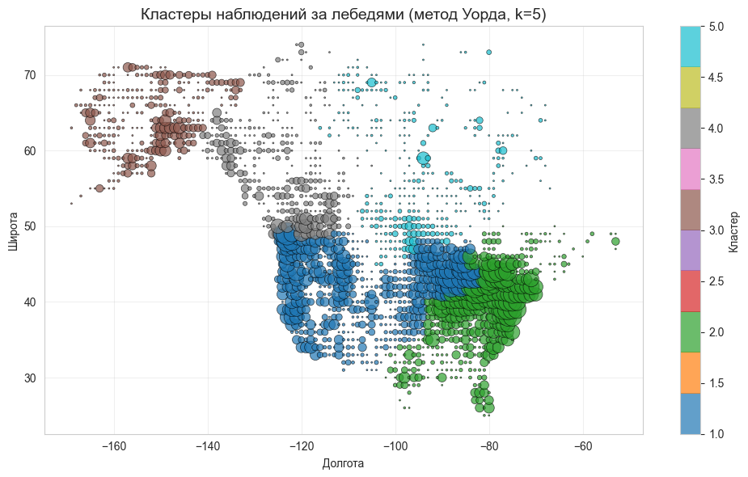
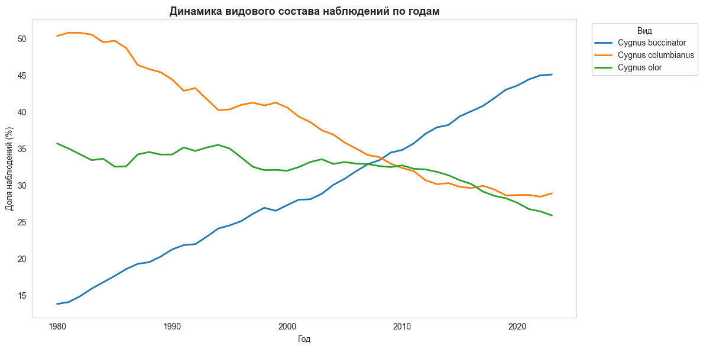

# Проект: Пространственно-временная динамика ареала лебедей в Северной Америке

**Описание:** анализ смещения ареала трёх видов лебедей (*Cygnus olor*, *Cygnus buccinator*, *Cygnus columbianus*) в США и Канаде по данным GBIF за 1980–2023 гг. Данные о наблюдениях обогащены температурой и плотностью населения, выполнены кластеризация методом Уорда, трендовый анализ по сезонам и кластерам, непараметрические тесты, бутстрап и множественная регрессия. Главный вывод: кажущийся «дрейф ареала на юг» в значительной степени объясняется изменением структуры выборки, а не поведением птиц.
[Проект выполнен в Jupyter Notebook](swan_range_spatiotemporal_dynamics.ipynb) (Python: pandas, numpy, scipy, statsmodels, scikit-learn, matplotlib, seaborn).

---

## Ситуация

Исследовательская задача: выяснить, смещается ли ареал лебедей в Северной Америке (например, в ответ на потепление) и одинаково ли это происходит в разных географических зонах. Источник данных - Global Biodiversity Information Facility (GBIF): **3 489 498** записей о наблюдениях за 1980–2024 гг.

Ключевые особенности контекста:
* число наблюдений ≠ число птиц: запись фиксирует факт встречи человека с лебедем, а не размер популяции;
* данные - смесь целевых научных учётов и любительских наблюдений (гражданская наука), их соотношение менялось во времени;
* выборка сильно неравномерна во времени: около 70% записей приходится на период после 2007 года;
* в датасете есть полностью пустые и неинформативные столбцы, а названия штатов и провинций в четырёх источниках записаны по-разному;
* для округа Колумбия отсутствуют данные о температуре;
* лебеди мигрируют, поэтому зимние и летние наблюдения нельзя анализировать вместе.

Данные представлены в четырёх файлах:
* `short.csv` - наблюдения за лебедями (~3,5 млн записей);
* `US_CA.csv` - плотность населения штатов США и провинций Канады (69 записей);
* `us_state_temperatures.csv` - среднемесячные температуры по штатам США (26 868 записей);
* `canada_temperatures.csv` - среднемесячные температуры по провинциям Канады (6 864 записи).

---

## Задача

1. Загрузить и очистить данные о наблюдениях, добавить внешние данные (температура и плотность населения по штатам и провинциям).
2. Выделить географические зоны с помощью кластерного анализа.
3. Учесть сезонность (зимовка и гнездование) и другие искажающие факторы.
4. Оценить тренды широты наблюдений по годам: в целом, по сезонам и по кластерам.
5. Сравнить виды и сезоны статистическими методами, оценить влияние температуры и плотности населения.
6. Проверить устойчивость выводов и построить визуализации.
7. Сформулировать выводы и ограничения анализа.

---

## Действия

### Очистка и подготовка данных
* удалены 8 столбцов: `locality` (4 пропуска) и 7 числовых столбцов вместе с `infraspecificEpithet`, полностью состоящие из пропусков;
* названия столбцов приведены к `snake_case` (функция `camel_to_snake`), `event_date` преобразован в `datetime`;
* оставлены три вида, страны `US` и `CA`, координаты в диапазоне 25–75° с.ш. и −170…−35° з.д.; удалены три столбца с единственным уникальным значением (`basis_of_record`, `taxon_rank`, `dataset_key`);
* данные ограничены `year <= 2023` (неполный 2024 год исключён).

### Внешние данные
* названия штатов и провинций приведены к единому виду: удалены артефакты вида `[4]`, аббревиатура `AB` заменена на `Alberta`, `Yukon` на `Yukon Territory`, подчёркивания в названиях штатов США заменены на пробелы;
* датасеты температур США и Канады приведены к единому формату (для Канады рассчитаны значения в °F) и объединены через `left join` по ключу `(state_province, year, month)`;
* 5 пропусков температуры относились к `District of Columbia`, отсутствующему в температурных данных: они заполнены средним по соседним штатам Maryland и Virginia за соответствующий месяц;
* к данным присоединена плотность населения.

### Сезонная фильтрация и агрегация
* оставлены только зимовка (декабрь–февраль) и гнездование (июнь–август), создан признак `period_type`;
* созданы 5 временных периодов `time_period` (1980–1988, 1989–1997, 1998–2006, 2007–2015, 2016–2023);
* координаты округлены до целых градусов, дубликаты по набору `(year, period_type, decimal_longitude, decimal_latitude, species)` удалены, чтобы ослабить перекос из-за повторных записей из одних и тех же мест: **1 289 670 → 33 095** наблюдений.

### Кластерный анализ
* наблюдения агрегированы в **1 756** ячеек-координат с весом (число наблюдений);
* координаты стандартизированы (`StandardScaler`), выполнена иерархическая кластеризация методом Уорда, выделено 5 кластеров;
* построены дендрограмма и карта кластеров, рассчитаны профили кластеров (число наблюдений, средние широта, долгота, температура).

### Тренды широты по годам
* линейная регрессия «широта ~ год» отдельно для зимовки и гнездования - по всему датасету и по каждому кластеру (наклон, `R²`, `p-value`, пересчёт в км за 43 года);
* бутстрап (1 000 итераций) для 95% доверительных интервалов наклона по каждому кластеру и сезону.

### Корреляционный анализ
* корреляции Пирсона и Спирмена: широта и температура (в целом и по сезонам), широта и плотность населения;
* связь числа наблюдений и плотности населения на уровне штатов и провинций (проверка гипотезы о влиянии числа наблюдателей);
* тепловая карта корреляций Спирмена.

### Сравнение групп
* тест Краскела–Уоллиса для сравнения видов по широте и температуре;
* тест Манна–Уитни для сравнения сезонов по широте;
* попарные сравнения видов с поправкой Бонферрони, боксплоты по видам.

### Множественная регрессия
* базовая модель `decimal_latitude ~ year + avg_temp_c + density_per`;
* расширенная модель с сезоном и видом в качестве dummy-переменных, проверка мультиколлинеарности через `VIF`.

### Проверка механизма смещения
* динамика видового состава наблюдений по годам (скользящее среднее по 5 годам);
* видоспецифичные тренды медианной широты гнездования в кластере 5, давшем самый сильный «южный сдвиг».

---

## Результат

### Данные и кластеры
* итоговый датасет: **33 095** наблюдений, из них 59,5% - зимовка и 40,5% - гнездование; виды представлены примерно поровну (36% / 33% / 31%);
* средняя широта зимовки **41,78°**, гнездования **49,25°** - миграция «зимой на юг, летом на север» подтверждается;
* пять кластеров образуют выраженную географическую структуру:
  * кластер 1 - запад и центр США и юг Канады (**13 580** наблюдений);
  * кластер 2 - восток США и юго-восток Канады (**12 743**);
  * кластер 3 - Аляска и северо-запад (**2 606**);
  * кластер 4 - западная субарктика (**2 853**);
  * кластер 5 - центральная и восточная субарктика (**1 313**).

### Смещение ареала: первая картина
* по всему датасету зимовка значимого тренда не показывает (наклон **+0,0046°/год**, p = 0,18), а гнездование «смещается на юг» на **≈266 км** за 43 года (p < 0,001);
* по кластерам (бутстрап, 95% ДИ) картина неоднородна:

| Кластер | Зимовка | Гнездование |
|---|---|---|
| **1 — Западный и Центральный** | значимый сдвиг на юг: **−98.0…−27.6 км** | значимый сдвиг на юг: **−153.0…−69.8 км** |
| **2 — Восточный** | значимый сдвиг на юг: **−169.5…−101.4 км** | значимый сдвиг на юг: **−243.4…−139.1 км** |
| **3 — Крайний Север** | значимый сдвиг на север: **+1.6…+304.4 км** *(за 32 года)* | тренд незначим: **−98.9…+54.4 км** |
| **4 — Субарктика** | значимый сдвиг на север: **+73.5…+197.4 км** | значимый сдвиг на юг: **−612.2…−286.1 км** |
| **5 — Арктика/Восток** | тренд незначим: **−391.3…+38.2 км** | значимый сдвиг на юг: **−1138.0…−744.8 км** |

* смещение гнездовий кластера 5 почти на 1 000 км за 43 года биологически неправдоподобно - это сигнал проверить данные, а не птиц.

### Что оказалось причиной
Первая гипотеза: «южный сдвиг» создаёт рост доли оседлого Cygnus olor на юге (наблюдателей там больше). Проверка её опровергла: доля C. olor в выборке снизилась с 34,5% (1980) до 24,2% (2023).

Изменился состав мигрирующих видов:

- доля C. columbianus (гнездится севернее, около 60° с.ш.) снизилась примерно с 50% до 29%;
- доля C. buccinator (гнездится южнее, около 49° с.ш.) выросла примерно с 14% до 45%.

Поскольку виды заметно различаются по широте (тест Краскела-Уоллиса: H = 4 528, p < 0,001 по широте), смена соотношения видов сама по себе сдвигает общий центр наблюдений на юг. Подтверждения из других расчётов:

- в кластере 5 (гнездование) у C. columbianus широта растёт (+235 км за 43 года), у C. buccinator почти не меняется (+2 км), хотя общий тренд кластера -758...-1 128 км; значимость трендов по отдельным видам отдельно не оценивалась;
- в множественной регрессии с видом и сезоном R² вырос с 0,113 до 0,654, а коэффициент при годе перестал быть значимым (p = 0,060);
- связь широты и плотности населения r = -0,69 (Спирмен): севернее живёт меньше людей, а значит меньше наблюдателей.

### Итоговые выводы
1. Смещение широты наблюдений есть, но зависит от сезона. Гнездование: -0,056° в год, около -266 км за 43 года (p < 0,001). Зимовка: значимого общего тренда нет (p = 0,18).

2. По кластерам картина разная. Кластеры 1 и 2: значимый южный сдвиг и зимой, и летом. Кластер 3: значимых трендов нет. Кластер 4: зимой сдвиг на север (+74...+197 км), летом на юг. Кластер 5: летом самый сильный южный сдвиг (-1 138...-745 км), зимой тренда нет.

3. Виды и сезоны различаются. Попарные тесты (Манн-Уитни, поправка Бонферрони) значимы для всех пар видов, p < 0,001. Медианная широта: C. columbianus заметно севернее остальных (до 65° с.ш. и выше), C. buccinator около 45° с.ш., C. olor около 41° с.ш. Летние наблюдения в среднем на 3° севернее зимних.

4. Сдвиг в данных не стоит читать как смещение ареала. Часть агрегированного тренда объясняется изменением видового состава выборки. Практический вывод для анализа: до оценки тренда нужно разделять сезоны и виды и смотреть, как менялся состав данных.

### Ограничения и следующие шаги

## Ограничения
- Число наблюдений не равно числу птиц; данные не являются случайной выборкой популяции (смесь научных учётов и любительских наблюдений, её доля менялась).
- Около 70% записей приходится на период после 2007 года; арктические кластеры представлены слабее умеренных.
- Дедупликация (год + сезон + округлённые координаты + вид) сокращает 1 289 670 записей до 33 095, выводы относятся к дедуплицированной выборке.
- Сезоны заданы месяцами (декабрь-февраль, июнь-август), а не подтверждёнными местами зимовки и гнездования.
- Для отдельных кластеров данных мало: зимой в кластере 3 n = 158, в кластере 5 n = 90, интервалы широкие.
- Влияние наблюдателей остаётся гипотезой: источник записи и его изменение во времени в анализе не моделировались.
- Северный зимний тренд кластера 4 нельзя считать доказательством климатического сдвига, причинная связь не проверялась.
- p = 0,060 для года не доказывает отсутствие биологического изменения, это отсутствие подтверждённого линейного тренда в данной модели.

## Следующие шаги
- Добавить в анализ источник записи (научный учёт или любительское наблюдение) и проверить, как его доля менялась по годам.
- Оценить значимость трендов по отдельным видам и кластерам (бутстрап).
- Сравнить результат с независимым источником данных о гнездовых и зимовочных ареалах.

---

## Инструменты и методы

* Python (Jupyter Notebook): pandas, numpy, scipy, scikit-learn, statsmodels, matplotlib, seaborn;
* методы анализа: иерархическая кластеризация (метод Уорда), линейная и множественная регрессия, бутстрап-ресемплинг, корреляции Пирсона и Спирмена, тесты Краскела–Уоллиса и Манна–Уитни с поправкой Бонферрони, диагностика мультиколлинеарности (`VIF`);
* логика анализа: раздельная обработка сезонов, контроль видового состава, проверка гипотез о смещении наблюдателя и об изменении структуры выборки.

---
Отчёт по проекту представлен в виде [файла jupyter notebook](swan_range_spatiotemporal_dynamics.ipynb).
